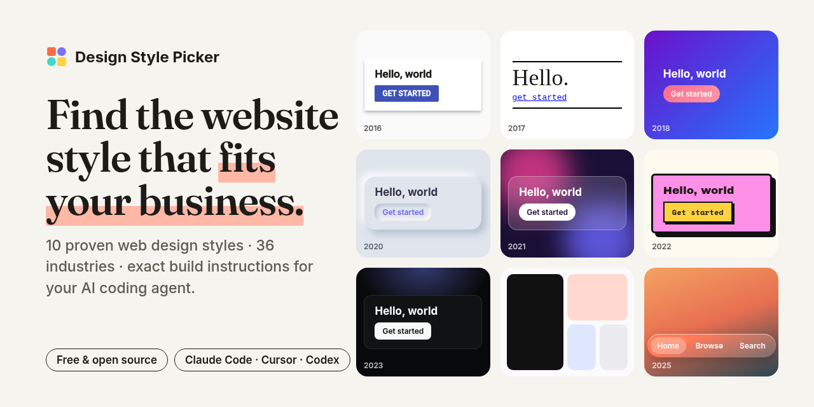
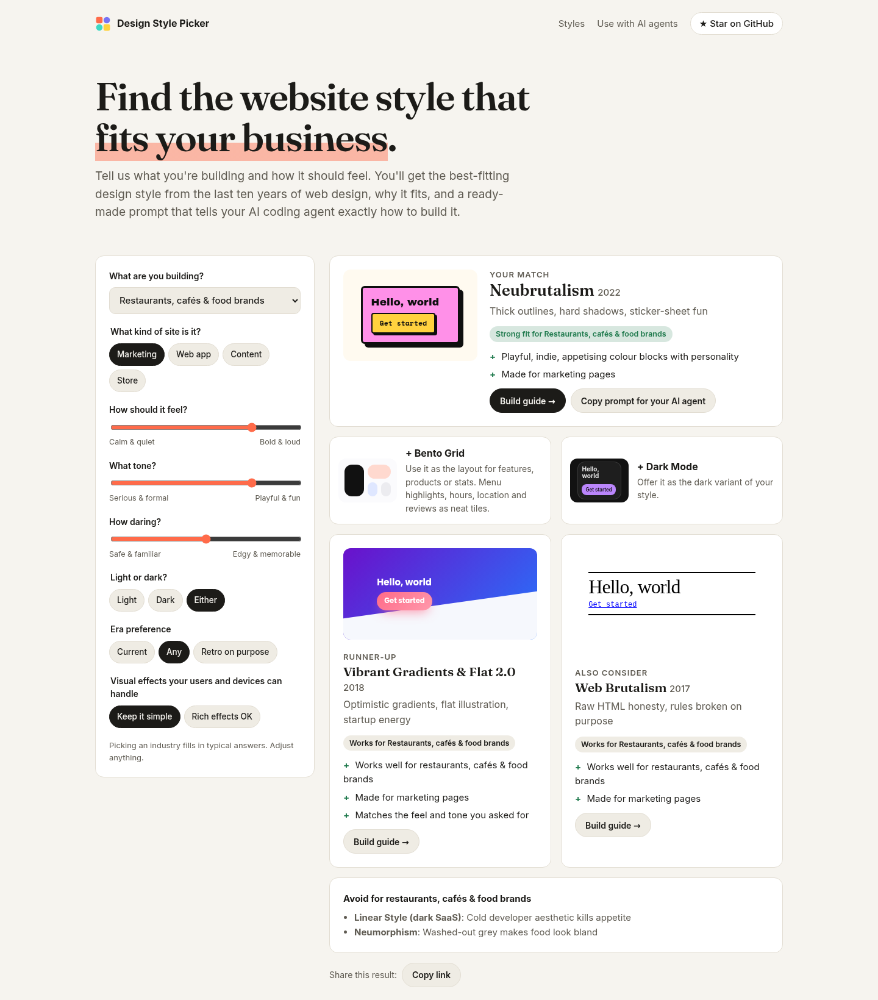

<div align="center">

# Design Style Picker

**Find the website design style that fits your business, then let your AI agent build it right.**

10 proven web design styles · 28 industries · sourced rules, design tokens and checklists for Claude Code, Cursor, Codex and any coding agent.

[**Try the picker →**](https://sunstonesoft.github.io/design-style-picker/) &nbsp;·&nbsp; [Install](#install) &nbsp;·&nbsp; [The styles](#the-styles) &nbsp;·&nbsp; [How it picks](#how-it-picks) &nbsp;·&nbsp; [Contribute](#contributing)

[](https://github.com/sunstonesoft/design-style-picker/actions/workflows/check.yml)
[](LICENSE)
[](#install)
[](CONTRIBUTING.md)



</div>

## The problem

Ask an AI agent to "make it look modern" and you get the same page as everyone else. Ask for "glassmorphism" and you get a guess, often with unreadable text. Most people don't know which style suits a dental clinic, a bakery or a dev tool, let alone what that style's rules actually are.

**Design Style Picker fixes both halves:**

1. **Pick.** Answer a few questions (industry, page type, how it should feel). You get the best-fitting style, a runner-up, compatible add-ons (bento layout, dark theme) and what to avoid for your industry, each with a reason.
2. **Build.** Each style comes with what its defining guides actually said, ready-to-use CSS design tokens, generic components, the style's known accessibility failures with fixes, and a checklist your agent ticks off before handing over.



## Quick start

**In the browser:** open the [picker](https://sunstonesoft.github.io/design-style-picker/), choose your industry, and hit **Copy prompt for your AI agent**.

**In your agent** (after [installing](#install)), just ask:

```text
Pick a design style for my dental clinic's website, then build the homepage.
```

```text
Make our pricing page glassmorphic, and do it properly.
```

```text
Audit this landing page against neubrutalism's rules.
```

## Install

**Claude Code (plugin):**

```bash
/plugin marketplace add sunstonesoft/design-style-picker
/plugin install design-style-picker@design-style-picker
```

**Claude Code (plain skill):** copy `skills/design-style-picker/` into `~/.claude/skills/` (all projects) or `.claude/skills/` (one project).

**Cursor, Codex, GitHub Copilot, Windsurf, Gemini CLI and others:** it's plain Markdown. Clone the repo next to your project or add it as a reference, then point your agent at [`AGENTS.md`](AGENTS.md). Or paste a single style file into your rules.

## The styles

One defining style per year of the last decade. Bento Grid and Dark Mode are **add-ons** (a layout and a theme) that combine with any base style.

| Year | Style | Feels like | Great for | Guide |
|---|---|---|---|---|
| 2016 | **Material Design** | clean, systematic, proven | apps, dashboards, healthcare, government | [guide](skills/design-style-picker/eras/2016-material-design.md) |
| 2017 | **Web Brutalism** | raw, confrontational, art-school | studios, portfolios, fashion | [guide](skills/design-style-picker/eras/2017-brutalism.md) |
| 2018 | **Vibrant Gradients & Flat 2.0** | optimistic, friendly, startup | kids, events, consumer apps | [guide](skills/design-style-picker/eras/2018-gradients-flat-2.md) |
| 2019 | **Dark Mode** *(theme add-on)* | calm, focused, pro tool | dev tools, gaming, dashboards | [guide](skills/design-style-picker/eras/2019-dark-mode.md) |
| 2020 | **Neumorphism** | soft, tactile, moulded | device showcases (sparingly) | [guide](skills/design-style-picker/eras/2020-neumorphism.md) |
| 2021 | **Glassmorphism** ⭐ *deep guide + [live demo](https://sunstonesoft.github.io/design-style-picker/demos/2021-glassmorphism/)* | airy, premium, macOS | music, gaming, web3 | [guide](skills/design-style-picker/eras/2021-glassmorphism.md) |
| 2022 | **Neubrutalism** ⭐ *deep guide + [live demo](https://sunstonesoft.github.io/design-style-picker/demos/2022-neubrutalism/)* | loud, playful, indie | restaurants, creators, events | [guide](skills/design-style-picker/eras/2022-neubrutalism.md) |
| 2023 | **Linear Style** (dark SaaS) ⭐ *deep guide + [live demo](https://sunstonesoft.github.io/design-style-picker/demos/2023-linear-style/)* | precise, premium, engineered | SaaS, dev tools, fintech | [guide](skills/design-style-picker/eras/2023-linear-style.md) |
| 2024 | **Bento Grid** *(layout add-on)* ⭐ *deep guide + [live demo](https://sunstonesoft.github.io/design-style-picker/demos/2024-bento-grid/)* | tidy, scannable, Apple keynote | feature overviews, stores, link-in-bio | [guide](skills/design-style-picker/eras/2024-bento-grid.md) |
| 2025 | **Liquid Glass** ⭐ *deep guide + [live demo](https://sunstonesoft.github.io/design-style-picker/demos/2025-liquid-glass/)* | fluid, physical, Apple | media, hardware, photo-led brands | [guide](skills/design-style-picker/eras/2025-liquid-glass.md) |

The [timeline](skills/design-style-picker/timeline.md) covers when each rose and fell, what it reacted against, and the runner-ups each year.

## How it picks

The logic is fully transparent: one data file, one small scoring function, written out for agents in [`picker.md`](skills/design-style-picker/picker.md).

- **Industry fit.** 28 industries rate each style *strong*, *works* or *avoid*, with a one-line reason ([`data/picker.json`](data/picker.json)).
- **Page fit.** Marketing site, web app, content site or store. Glass is great for a landing page and poor for a data table.
- **Your taste.** Calm ↔ bold, serious ↔ playful, safe ↔ edgy, light/dark, current or retro.
- **Effect tolerance.** High-risk effects (transparency, blur) cost more when your users are on older devices. Accessibility fixes are applied either way.
- **Regression-tested.** [`data/scenarios.json`](data/scenarios.json) pins real briefs (bakery, dental clinic, crypto exchange, government portal…) so a data change can't quietly break recommendations.

## What's inside

```
skills/design-style-picker/
├── SKILL.md            # entry point: pick → build → verify
├── picker.md           # questions, scoring, industry matrix (generated part)
├── timeline.md         # 2016–2025 at a glance, lineage, 2026 watch list
├── eras/               # one build guide per style (_TEMPLATE.md for new ones)
└── examples/           # runnable demos (2021 glassmorphism)
data/picker.json        # traits, industry fits, weights: the single source of truth
data/scenarios.json     # regression briefs
docs/                   # the website (GitHub Pages)
scripts/                # build, check, scenario tests (Node 18+, zero dependencies)
```

Every style guide has the same sections: **Snapshot · Origin & timeline · Textbook rules · Tokens · Components · Do / Don't · Accessibility · Agent checklist · Sources.**

## Principles

- **Sourced, not vibes.** Dates and rules link to the guides and essays that defined each style. Unverified claims are marked.
- **Original only.** Components are generic and brands are fictional. Real sites are named for context, never copied.
- **Accessible by default.** Every style lists how it typically fails users and the fix that keeps the look.
- **Agent-shaped.** Rules are instructions, numbers are tokens, and every guide ends in a checklist.

## Roadmap

The full plan is in **[ROADMAP.md](ROADMAP.md)**. Highlights:

- **v0.2 · Depth:** deep guides and live demos for Neubrutalism, Linear Style, Bento and Liquid Glass; one brief rendered in every style; a "was this right?" button
- **v0.3 · Coverage:** editorial/serif, Swiss, warm organic, claymorphism, Y2K and more; sub-industries; per-style and per-industry pages
- **v0.4 · Tooling:** token packages (CSS, Tailwind, shadcn, DTCG), a CLI, an MCP server
- **v0.5 · Trust:** a designer-reviewed calibration set, agent build evals, an automated style audit
- **v1.0 and beyond:** a style detector, data-backed design history from HTTP Archive, Figma and VS Code integrations

## Contributing

The most useful contributions: **take a style deep**, **fix a recommendation** for an industry you know, or **propose a missing style**. There are [issue forms](https://github.com/sunstonesoft/design-style-picker/issues/new/choose) for each. See [CONTRIBUTING.md](CONTRIBUTING.md).

```bash
npm run build   # regenerate the matrix and website data after editing data/picker.json
npm run check   # validate guides, generated files and regression scenarios
```

If this helped you ship a better-looking site, **[star the repo](https://github.com/sunstonesoft/design-style-picker)** and share what you built in [Show and tell](https://github.com/sunstonesoft/design-style-picker/discussions/categories/show-and-tell).

## Related projects

Style libraries with a different, non-picking angle: [bergside/awesome-design-skills](https://github.com/bergside/awesome-design-skills) (67 style skills), [chrismccoy/claude-design-styles](https://github.com/chrismccoy/claude-design-styles) (53 style specs with demos).

## License

[MIT](LICENSE) © Sunstone Soft
